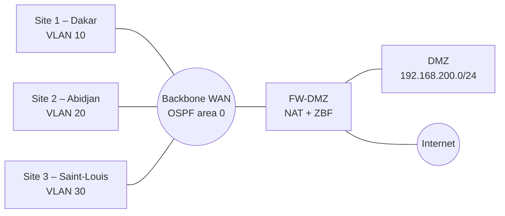

# Lab réseau multi-sites automatisé (GNS3 · Python · Netmiko · Jinja2)


Outil d'automatisation qui configure un laboratoire réseau de **3 sites** (Dakar,
Abidjan, Saint-Louis) et une **DMZ** sous GNS3, à partir d'un simple inventaire YAML.

Il pousse automatiquement : VLAN, trunks 802.1Q, sous-interfaces (*router-on-a-stick*),
OSPF, *portfast*, NAT et pare-feu à zones (ZBF) sur des équipements Cisco IOS.



## Points clés

- **Données séparées du code** : la topologie est décrite dans `inventory.yaml`, la
  syntaxe Cisco dans des gabarits Jinja2 ; aucune adresse ni commande en dur dans le Python.
- **Découverte automatique** : l'inventaire ne contient que des adresses IP. Le type
  d'équipement est détecté par `SSHDetect`, le rôle et le site sont déduits du hostname.
- **Sûreté** : sauvegarde du *running-config* avant toute modification, journal horodaté,
  génération à blanc (`--dry-run`) pour relire les configurations avant envoi.
- **Générique** : ajouter un site = ajouter un bloc dans l'inventaire, sans toucher au code.
- **Testé** : 17 tests unitaires (`pytest`) exécutés automatiquement par GitHub Actions.

## Démarrage rapide

```powershell
git clone https://github.com/elie-03/projet-devnet-campus.git
cd projet-devnet-campus
python -m venv .venv
.\.venv\Scripts\Activate.ps1          # Linux/macOS : source .venv/bin/activate
pip install -r requirements.txt

pytest -v                              # tests unitaires, sans lab
python run.py --dry-run                # configurations générées dans output/
```

Déploiement sur le lab (une fois les équipements joignables en SSH) :

```powershell
$env:LAB_USERNAME = "admin"
$env:LAB_PASSWORD = "<mot de passe>"
$env:LAB_SECRET   = "<mot de passe enable>"
python run.py
```

## Documentation

| Étape | Document |
|---|---|
| 1. Architecture, adressage, flux autorisés | [docs/01-architecture.md](docs/01-architecture.md) |
| 2. Préparation de GNS3 et câblage | [docs/02-preparation-gns3.md](docs/02-preparation-gns3.md) |
| 3. Configuration initiale des équipements | [docs/03-configuration-initiale.md](docs/03-configuration-initiale.md) |
| 4. Poste d'automatisation | [docs/04-poste-automatisation.md](docs/04-poste-automatisation.md) |
| 5. Utilisation, vérifications, retour arrière | [docs/05-utilisation.md](docs/05-utilisation.md) |
| 6. Dépannage | [docs/06-depannage.md](docs/06-depannage.md) |

## Structure du dépôt

```
├── inventory.yaml        # topologie et paramètres (aucun secret)
├── run.py                # point d'entrée : --dry-run ou déploiement
├── src/                  # inventaire, connexion, rendu, envoi, vérifications
├── templates/            # gabarits Jinja2 par rôle
├── tests/                # tests pytest
└── docs/                 # documentation pas à pas
```

## Auteurs

- Elie MBALA LUKANDA LUIMBU – [LinkedIn](https://www.linkedin.com/in/elie-mbala-lukanda-luimbu-88b47a187)
- Ngaty SARR

## Transparence

Code et documentation élaborés avec l'assistance de l'IA Claude (Anthropic),
puis testés et adaptés par les auteurs.

## Avertissements

- Projet pédagogique destiné à un laboratoire GNS3, **pas à un réseau de production**.
- **Aucune image Cisco n'est fournie** : utilisez uniquement des images dont vous
  détenez légalement la licence.
- Les identifiants sont lus dans des variables d'environnement : ne les écrivez
  jamais dans le code ni dans l'inventaire.

## Licence

Distribué sous licence MIT : voir [LICENSE](LICENSE).
