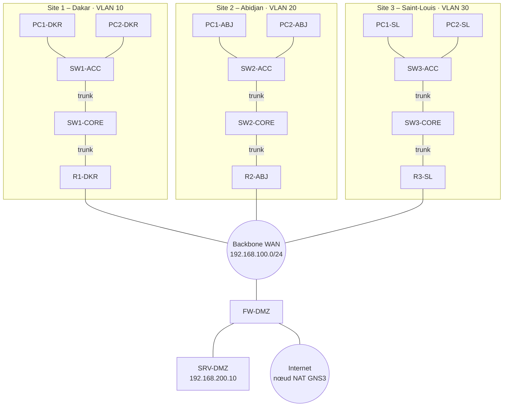

# 1. Architecture du laboratoire

[← Retour au README](../README.md) · [Étape suivante →](02-preparation-gns3.md)

## Vue d'ensemble

Trois agences sont reliées par un backbone routé en OSPF (aire 0). Chaque agence a un
VLAN d'accès, un switch d'accès, un switch cœur (couche 2) et un routeur qui sert de
passerelle (*router-on-a-stick*). Un pare-feu central protège une DMZ et assure la
sortie Internet avec NAT.

Un réseau de **management hors bande** (192.168.10.0/24) relie une interface dédiée de
chaque équipement au poste d'automatisation, indépendamment du réseau de production.

## Plan d'adressage

| Réseau | Adresse | Passerelle / équipements | Rôle |
|---|---|---|---|
| VLAN 10 – Dakar | 10.10.10.0/24 | R1-DKR 10.10.10.1 | Postes du site 1 |
| VLAN 20 – Abidjan | 10.20.20.0/24 | R2-ABJ 10.20.20.1 | Postes du site 2 |
| VLAN 30 – Saint-Louis | 10.30.30.0/24 | R3-SL 10.30.30.1 | Postes du site 3 |
| Backbone WAN | 192.168.100.0/24 | R1 .1 · R2 .2 · R3 .3 · FW-DMZ .254 | OSPF aire 0 |
| DMZ | 192.168.200.0/24 | FW-DMZ .254 · SRV-DMZ .10 | Serveurs exposés |
| Management | 192.168.10.0/24 | Équipements .1 à .16 · poste .100 | SSH de l'outil |
| Internet | DHCP | FW-DMZ Fa1/0 | Sortie réelle via GNS3 |

## Postes

| Poste | Adresse | Passerelle | Raccordement |
|---|---|---|---|
| PC1-DKR / PC2-DKR | 10.10.10.10 / .20 | 10.10.10.1 | SW1-ACC Fa1/1 · Fa1/2 |
| PC1-ABJ / PC2-ABJ | 10.20.20.10 / .20 | 10.20.20.1 | SW2-ACC Fa1/1 · Fa1/2 |
| PC1-SL / PC2-SL | 10.30.30.10 / .20 | 10.30.30.1 | SW3-ACC Fa1/1 · Fa1/2 |
| SRV-DMZ | 192.168.200.10 | 192.168.200.254 | FW-DMZ Fa0/1 |

## Interfaces par rôle

| Équipement | Management | Production |
|---|---|---|
| R1-DKR, R2-ABJ, R3-SL (c7200) | Fa1/0 → .1 / .2 / .3 | Fa0/0 : trunk vers SWx-CORE · Fa0/1 : backbone WAN |
| FW-DMZ (c7200) | Fa1/1 → .4 | Fa0/0 : WAN (INSIDE) · Fa0/1 : DMZ · Fa1/0 : Internet |
| SW1/2/3-CORE (c3725 EtherSwitch) | Fa0/0 → .11 / .13 / .15 | Fa1/0 : trunk vers routeur · Fa1/1 : trunk vers SWx-ACC |
| SW1/2/3-ACC (c3725 EtherSwitch) | Fa0/0 → .12 / .14 / .16 | Fa1/0 : trunk vers SWx-CORE · Fa1/1-1/2 : postes |

Ces correspondances sont déclarées dans la section `interfaces` de `inventory.yaml` :
pour une autre plate-forme, il suffit de les modifier.

## Flux autorisés par le pare-feu

| Source → destination | Politique | Effet |
|---|---|---|
| Sites (INSIDE) → Internet (OUTSIDE) | Inspection TCP, UDP, ICMP + NAT | Navigation possible, retours autorisés automatiquement |
| Sites (INSIDE) → DMZ | Inspection HTTP, HTTPS, ICMP | Accès au serveur DMZ |
| DMZ → Sites | Aucune paire de zones | **Refusé** : un serveur compromis ne peut pas atteindre les sites |
| Internet → Sites / DMZ | Aucune paire de zones | **Refusé** |
| Vers le pare-feu lui-même (zone *self*) | Autorisé par défaut | OSPF et SSH de management fonctionnent |
