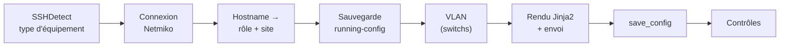

# 4. Poste d'automatisation

[← Configuration initiale](03-configuration-initiale.md) · [Étape suivante →](05-utilisation.md)

## Outils (Windows)

```powershell
winget install -e --id Python.Python.3.12
winget install -e --id Git.Git
winget install -e --id Microsoft.VisualStudioCode
# Fermer puis rouvrir PowerShell
python --version ; git --version
```

Sous Linux ou macOS, Python 3.11 ou plus récent et Git suffisent.

## Environnement virtuel

```powershell
git clone https://github.com/elie-03/projet-devnet-campus.git
cd projet-devnet-campus
python -m venv .venv
Set-ExecutionPolicy -Scope Process -ExecutionPolicy Bypass -Force   # si l'activation est bloquée
.\.venv\Scripts\Activate.ps1
pip install -r requirements.txt
```

L'environnement virtuel isole les bibliothèques du projet : le dossier `.venv` peut être
supprimé et recréé à tout moment.

## Identifiants

```powershell
$env:LAB_USERNAME = "admin"
$env:LAB_PASSWORD = "<mot de passe admin>"
$env:LAB_SECRET   = "<mot de passe enable>"
```

Ces variables n'existent que dans la fenêtre PowerShell courante. Les noms des variables
se règlent dans la section `credentials` de `inventory.yaml`.

## Architecture du code

| Fichier | Rôle |
|---|---|
| `inventory.yaml` | Sites, VLAN, adresses, interfaces par rôle, liste des IP de management |
| `src/inventory.py` | Chargement et validation de l'inventaire, lecture des identifiants |
| `src/utils.py` | Hostname → rôle / site, calculs d'adresses, journalisation |
| `src/render.py` | Génération des configurations à partir des gabarits Jinja2 |
| `src/connect.py` | Détection du type d'équipement (`SSHDetect`) et connexion Netmiko |
| `src/push_config.py` | Sauvegarde, création des VLAN, envoi, enregistrement |
| `src/verify.py` | Contrôles après déploiement |
| `templates/*.j2` | Syntaxe Cisco par rôle : routeur, switch cœur, switch d'accès, pare-feu |
| `run.py` | Point d'entrée : `--dry-run` ou déploiement |

Déroulement pour chaque équipement :


